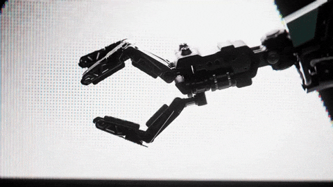
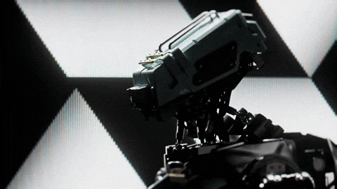
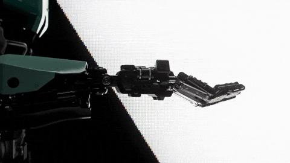
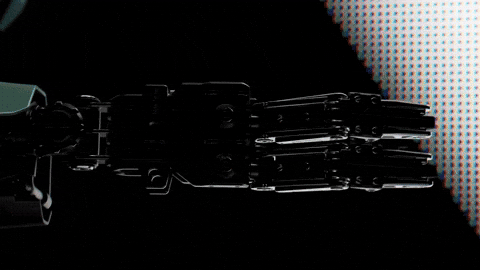

  
  
  
  

### Projects

* [AnyConvert](https://github.com/InQueApps/unimediaconv)
* [VisionTechAI](https://github.com/InQueApps/VisionTechAI)
* [RenderingEngine](https://github.com/Vipresz/RenderingEngine) — C++ game engine with ECS, OpenGL rendering, and input
* [OusterSDKWrapper](https://github.com/romangrigorii/OusterSDKWrapper) — Wrapper for the Ouster LiDAR SDK that streams a live sensor into an application
* [terrain-gen](https://github.com/romangrigorii/terrain-gen) — Python procedural worlds from plate tectonics, rivers, climate, and biomes
* Owner of [@InQueApps](https://github.com/InQueApps)
* Owner of [@Vipresz](https://github.com/Vipresz)
